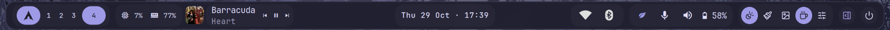
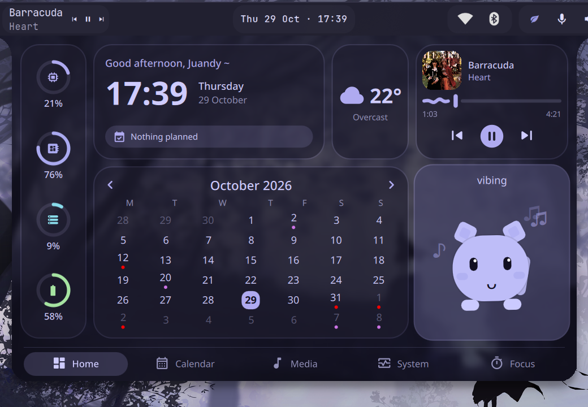
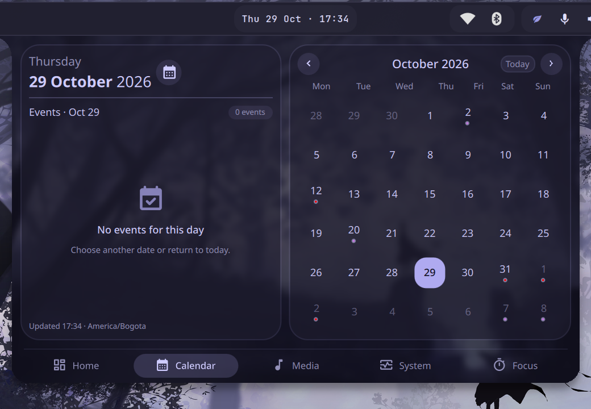
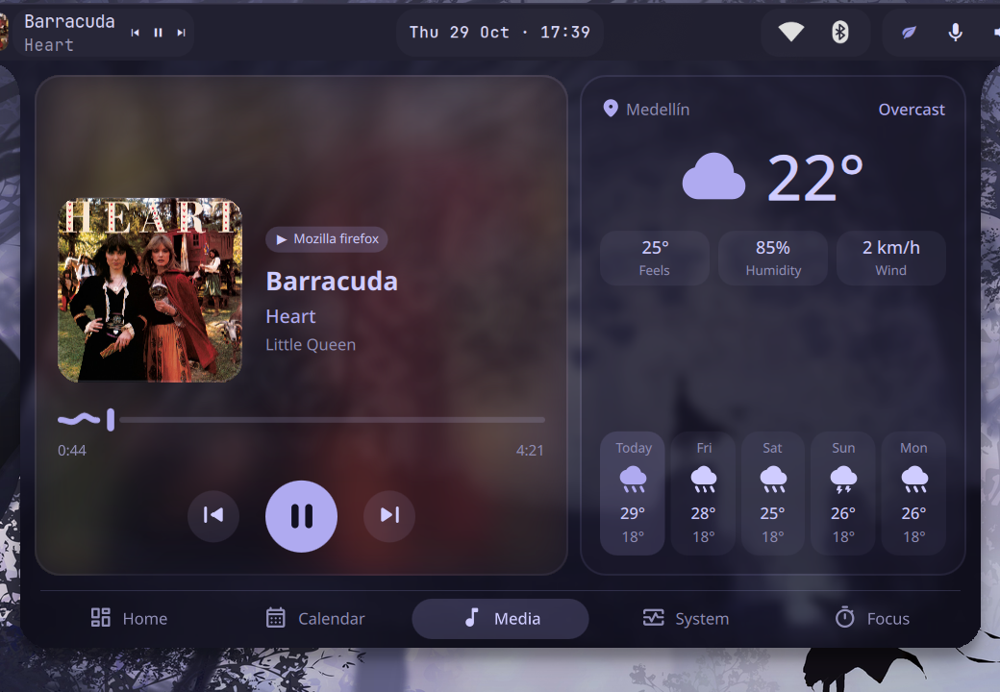
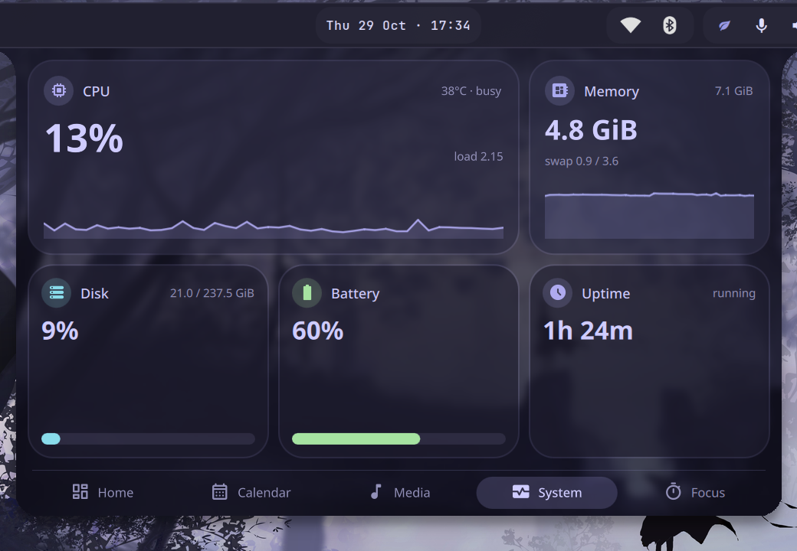
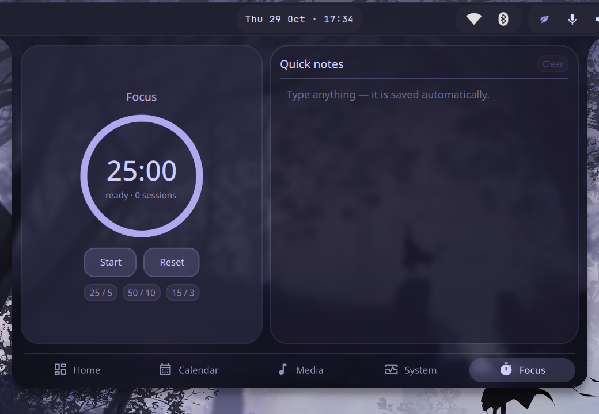
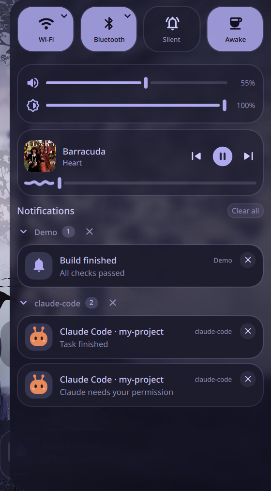
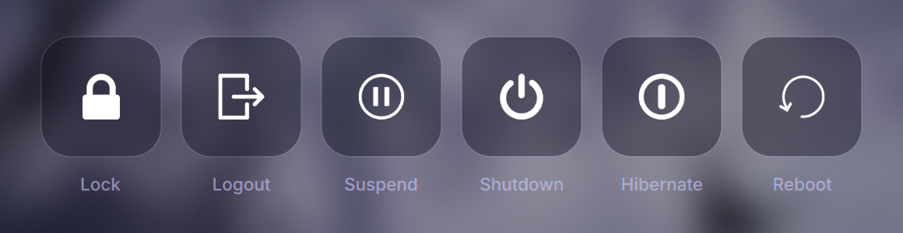

# Components

## Waybar
Layout `config/waybar/layouts/Unified.jsonc` (installed as `config.jsonc`), styles in `styles/unified.css` and `user-style.css`, Lucide icons in `assets/`. Colors follow HyDE's wallbash theme.

## Dashboard
`config/quickshell/calendar`. Toggle: `quickshell ipc -c calendar call calendar toggle`; tabs: `... call calendar tab 0..4`.

| Home | Calendar |
|---|---|
|  |  |
| **Media** | **System** |
|  |  |

## Notification center
`config/quickshell/notifications`, controlled by `notif {toggle|open|close|toggleDnd|clear}`. Also acts as the notification daemon.

## Power menu
`config/quickshell/powermenu`, toggled by `hyde-qs-powermenu` (falls back to wlogout).

## Screenshots
`config/quickshell/screenshot` + `bin/shot`. Files go to `~/Pictures/Screenshots` and the clipboard.

## Helpers
`bin/hyde-qs-media` (album art, seek, focus the player window), `bin/waybar-nowplaying`, `bin/notif`, `bin/shot`.
